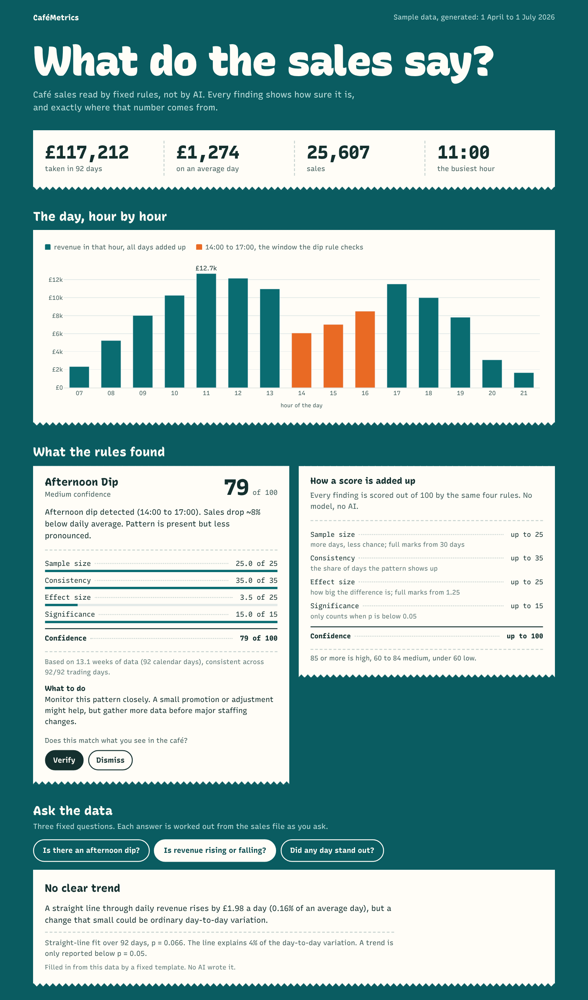

# CaféMetrics: Rule-Based Café Sales Analytics with Transparent Confidence Scoring

[](https://github.com/rebekaolar-cyber/cafemetrics/actions/workflows/tests.yml)

**Live demo: https://cafemetrics.onrender.com** — hosted on a free instance, so the first request after a quiet spell takes up to a minute to wake it.

A portfolio-quality analytics dashboard for café sales data that uses **rule-based statistical analysis** (no LLM) and **transparent confidence scoring** to generate auditable, actionable insights.



## Problem

Café managers need to understand sales patterns and make decisions based on evidence, not guesses. Off-the-shelf dashboards show *what happened*, but don't explain *why* or *how confident* the insights are.

## Solution

CaféMetrics computes three core insights (afternoon dips, trends, anomalies) from statistical analysis and assigns each a **confidence score** based on:
- **Sample size** (more data = higher confidence, plateaus at 30 days)
- **Consistency** (how often the pattern occurs)
- **Effect size** (magnitude of the effect, using Cohen's d scale)
- **P-value** (statistical significance)

**Every insight is fully auditable**: the formula is documented, each score includes a basis line (e.g., "6 weeks of data, consistent 28/30 weekdays"), and users can verify or dismiss insights with an audit trail.

## Architecture

```
cafemetrics/
  data/                              # Sample data generation
    generate_sample_data.py
    sample_sales.csv
  
  src/                               # Core analysis modules
    __init__.py
    data_loader.py                   # Load + validate CSV
    metrics.py                        # KPIs (revenue, peak hour, etc.)
    analysis.py                       # Pattern detection (dips, trends, anomalies)
    confidence.py                     # Confidence scoring formula (centerpiece)
    insights.py                       # Template-based insight generation
    answers.py                        # The three fixed questions, answered from the analysis
    verification.py                   # SQLite for audit trail
  
  app/
    dashboard.py                      # Dash UI: structure and callbacks
    assets/                           # style.css, the Recursive font, favicon
  
  tests/                              # pytest suites for all modules
    test_*.py
  
  requirements.txt                    # Pinned dependencies
  README.md
```

## Key Features

### 1. Transparent Confidence Scoring (The Centerpiece)

The formula combines four weighted components:

```
score = 0.25×size_score + 0.35×consistency_score + 0.25×effect_score + 0.15×p_value_score
```

- **size_score**: min(100, (sample_size / 30) × 100) — plateaus at 30 days
- **consistency_score**: consistency_ratio × 100 — human-readable percentage
- **effect_score**: min(100, effect_size × 80) — Cohen's d scale
- **p_value_score**: (1 – p_value) × 100 if p < 0.05, else 0

**Findings with no test behind them**: the unusual-day scan compares rolling z-scores against a
threshold and performs no hypothesis test, so there is no p-value to score. Its findings are
scored on the first three components, rescaled to still total 100
(0.294 / 0.412 / 0.294) — not handed a nominal p-value, and not scored as though a test had run
and failed. Those are three different claims and only one of them is true.

**Bands**: HIGH (≥85), MEDIUM (60–84), LOW (<60)

Every score includes a **basis** line: "6 weeks of data, consistent across 28/30 weekdays."

The dashboard prints each score **itemised, like a till receipt**: the points earned by each of
the four parts (`confidence_breakdown()`), so you can see at a glance why a finding is only
"medium". In the sample data the afternoon dip scores 79: full marks for sample size,
consistency and significance, but 3.5 of 25 for effect size, because the dip is small.

### 2. Three Core Analyses

- **Afternoon Dip**: Paired t-test comparing revenue in hours 14–16 to every other open hour. Returns effect size with a bootstrap confidence interval, sample size, p-value → confidence.
- **Trend**: Linear regression on daily revenue with the day-of-week effect removed first. Returns slope with a bootstrap confidence interval, p-value, partial R² → confidence.
- **Anomalies**: Z-score detection of outlier days. Returns anomaly count, ratio, mean z-score → confidence.

The dip and trend tests share one dataset, so their p-values are corrected together
(Benjamini–Hochberg) before anything is reported; the corrected value decides what is reported
and feeds the confidence score, and the raw value stays on screen beside it. See
[Why some patterns are not reported](#why-some-patterns-are-not-reported).

### 3. Rule-Based Insights, Not LLM

Insights use templates selected by confidence band:

```python
if band == "HIGH":
    text = "Strong afternoon dip detected (14:00 to 17:00). Sales are ~8% lower..."
    action = "Consider reducing staff or running a targeted promotion."
elif band == "MEDIUM":
    text = "Afternoon dip detected. Pattern is present but less pronounced."
    action = "Monitor closely. Gather more data before major changes."
else:  # LOW
    text = "Possible afternoon dip, but the pattern is weak..."
    action = "Collect more data before taking action."
```

No AI generation, no hallucinations. Every word is predictable and auditable.

### 4. Human-in-the-Loop Verification

Users can:
- **Verify** insights they've confirmed
- **Dismiss** false positives
- View an audit trail with timestamps

All stored in SQLite (`insights.db`).

### 5. Fixed Q&A, Not Free-Form LLM

The dashboard includes three preset questions. Each answer is a template filled in from the
analysis of the loaded data (`src/answers.py`), so it can only say what the data shows:
- "Is there an afternoon dip?" → the two averages, the gap, the test and effect size
- "Is revenue rising or falling?" → the slope, its p-value and R², or "no clear trend"
- "Did any day stand out?" → the outlier dates, or "no day stands out", with the rule used

When the rules find nothing, the answer says so and shows the numbers. On the sample data two of
the three answers are "nothing found".

No free-form text box, no LLM API calls.

## Why some patterns are not reported

A dashboard that only ever finds things is not measuring anything. On the shipped sample data
(92 days) the rules report **one** finding out of three, and the reasons are worth reading —
they are the same reasons the numbers can be trusted when something *is* reported.

**The trend that isn't: revenue looks like it's rising, and it is not reported.**
Daily revenue drifts up by about £1.91 a day. But the range of drifts consistent with this data
runs from **−£0.03 to £3.85 a day** (95% confidence) — it includes zero, so "no change at all"
is still on the table. The formal test agrees: p = 0.054, just the wrong side of the 0.05 line
the project reports at. Two steps got it there, and both are documented in `src/analysis.py`:

- *The weekly pattern is removed first.* Saturdays take far more than Tuesdays, and a 92-day
  window never holds equal numbers of each weekday. A plain line fitted through daily revenue
  can therefore slope purely because of which weekdays the window begins and ends on. Taking the
  day-of-week effect out first moved this p-value from **0.066 to 0.054** — the weekly rhythm was
  slightly flattering the trend, not creating it.
- *Three tests on one dataset means three chances to get lucky.* Run enough tests and one comes
  back "significant" by accident. The Benjamini–Hochberg correction raises each p-value to
  account for the others in the family, and the dashboard shows the raw and the corrected value
  side by side.

So the honest answer is: revenue may well be rising, but 92 days is not enough to tell it apart
from an ordinary good run. The dashboard says exactly that, with the numbers.

**The dip that is reported, but only at 79 out of 100.**
Afternoons from 14:00 to 17:00 really are quieter: £78 in an average hour against £85 across the
day, and the test is about as certain as tests get (p < 0.001 even after correction). What holds
the score down is that **8% is a small difference**. The effect size is 0.18 (95% confidence
0.12 to 0.23), which on the conventional scale is small — so that part of the score earns
**3.5 points out of 25**, and the finding lands in the MEDIUM band rather than HIGH. Certain
that it happens; not a big enough gap to justify a drastic change.

**No unusual days — and a known defect behind that answer.** None of the 92 days sits more than
2.5 standard deviations from the week running up to it. The sample data has no closures,
heatwaves or festivals in it, so this is the expected answer. But it is also the *only* answer
this check can currently give: each day is scored against a 7-day window that **includes
itself**, which bounds the score at 6/√7 = 2.268 — below the 2.5 threshold. A single day of a
billion pounds would still score 2.268. So `detect_anomalies()` reports nothing at its default
setting whatever the data, and that is a bug, not a result. It is pinned by a test, documented in
the function, and fixed by scoring each day against the window *before* it; that change alters
which days the dashboard reports, so it belongs in its own commit.

**The one number no statistics can supply.** A reported dip says the afternoons *are* quieter.
It does not say why, and nothing in this repo pretends otherwise.

## Installation & Setup

### Prerequisites
- Python 3.11 (the pinned numpy does not install on Python 3.12 or newer)
- pip

### Install

```bash
git clone <repo>
cd cafemetrics
pip install -r requirements.txt
```

### Generate Sample Data

```bash
python data/generate_sample_data.py
```

This creates `data/sample_sales.csv` with ~25k realistic transactions across 92 days, including:
- Hourly patterns (peak at lunch/evening, afternoon dip 14–16)
- Day-of-week variation (weekends +15%)
- Subtle upward trend
- A 30% anomaly in week 4

### Run the Dashboard

```bash
python app/dashboard.py
```

Then visit `http://localhost:8050` in your browser.

## Testing

Run all tests:

```bash
pytest -v
```

Coverage includes:
- **test_data_loader.py**: validation, aggregation, spans
- **test_metrics.py**: KPIs, edge cases (empty data, ties)
- **test_analysis.py**: pattern detection, statistical rigor
- **test_confidence.py**: scoring formula, weight interactions, edge cases, the itemised breakdown
- **test_insights.py**: templating, confidence bands, actions, recorded evidence
- **test_answers.py**: the three fixed questions, including every "nothing found" case
- **test_verification.py**: audit trail, status updates
- **test_dashboard.py**: the page builds from the sample data; receipts, stamps, chart marking

**Total: 112 tests, all passing.**

## Project Structure & Design Decisions

### 1. Why No LLM Calls?

LLMs can hallucinate or overstate confidence. For a portfolio piece and a real business tool, rule-based analysis is:
- Reproducible
- Auditable
- Transparent
- Honest about uncertainty

### 2. Why the Confidence Formula?

Many dashboards show "insights" without explaining how confident they are. By combining sample size, consistency, effect size, and p-value, CaféMetrics makes confidence explicit and defensible.

The weights (35% on consistency, 25% on sample size, 25% on effect, 15% on p-value) reflect the philosophy: **Human judgment is more confident in patterns they've seen repeatedly**, even if the effect is small. Statistical significance matters, but doesn't dominate.

### 3. Why SQLite, Not a Cloud DB?

For a portfolio piece, SQLite keeps the project self-contained. It's portable, requires no setup, and demonstrates understanding of persistence patterns. A production system would use PostgreSQL or similar.

### 4. Why Dash, Not React?

Dash is Python-native, integrates seamlessly with pandas/numpy, and is fast to build. For a portfolio, it shows full-stack capability without context-switching to JavaScript.

## Module Documentation

### `src/confidence.py` (Centerpiece)

The confidence formula is the core of the portfolio. Read the docstring for detailed explanation of weights and rationale.

```python
from src.confidence import compute_confidence, score_to_band, confidence_basis

score = compute_confidence(
    sample_size=30,
    consistency_ratio=0.90,
    effect_size=0.25,
    p_value=0.001,
)
band = score_to_band(score)  # "HIGH", "MEDIUM", or "LOW"
basis = confidence_basis(30, 0.90, 92)
# "4.3 weeks of data (92 calendar days), consistent across 27/30 trading days"
```

### `src/analysis.py`

Three detection functions, each returning raw stats for confidence scoring:

```python
from src.analysis import analyze_all, detect_afternoon_dip, detect_trend, detect_anomalies

dip = detect_afternoon_dip(df)
# Returns: sample_size, effect_size, effect_size_ci, p_value, p_value_corrected,
#          family_size, dip_avg_revenue, overall_avg_revenue

trend = detect_trend(df)
# Returns: slope, slope_ci, slope_pct, p_value, p_value_corrected, family_size,
#          r_squared, and the pre-adjustment fit as *_unadjusted

anomalies = detect_anomalies(df, z_threshold=2.5)
# Returns: anomaly_count, anomaly_ratio, anomalous_dates, mean_z_score

# analyze_all() runs all three and corrects the family's p-values together.
# A detector called on its own is a family of one: p_value_corrected == p_value.
analysis = analyze_all(df)
```

### `src/statistics_support.py`

The shared statistical machinery, kept out of `analysis.py` so each piece is testable alone:
Benjamini–Hochberg correction, a seeded percentile bootstrap
(seed `20260401`, 2000 resamples, 95% intervals — change the seed and every published
interval changes), and the weekday-adjusted trend fit.

### `src/insights.py`

Template-based insight generation:

```python
from src.insights import generate_all_insights

insights = generate_all_insights(df)
for insight in insights:
    print(f"{insight.title} ({insight.confidence_band})")
    print(f"  Score: {insight.confidence_score}/100")
    print(f"  Basis: {insight.basis}")
    print(f"  Action: {insight.suggested_action}")
```

### `src/verification.py`

Audit trail for human-in-the-loop decisions:

```python
from src.verification import save_insight, update_insight_status, get_insights

insight_id = save_insight("Afternoon Dip", "afternoon_dip", 79)
update_insight_status(insight_id, "verified", notes="Confirmed during staff review")
insights = get_insights(status="verified")
```

## Example Output

Running `python data/generate_sample_data.py && python app/dashboard.py` generates:

```
✓ Afternoon Dip
  Confidence: 79/100 (MEDIUM)
  Basis: 13.1 weeks of data (92 calendar days), consistent across 92/92 trading days
  Text: Afternoon dip detected (14:00 to 17:00). Sales drop ~8% below daily average...
  Action: Monitor this pattern closely. A small promotion might help...

✓ No significant trend detected

✓ No major anomalies detected
```

## Future Work

The TODO in `src/insights.py` marks room for an optional **free-form insight parser** that could (in a future iteration):
- Accept natural language questions ("When does revenue peak?")
- Use a small, fine-tuned model (not GPT) to map questions to analysis functions
- Return rule-based answers

For now, the fixed buttons are intentional: they prove the core analysis works and demonstrate restraint in not over-engineering.

## Code Quality

- **Type hints** on all public functions
- **Docstrings** on all modules and public functions
- **No comments in code** (docstrings handle the why; names handle the what)
- **112 tests** covering happy paths, edge cases, and error conditions
- **Clean git history** with one-commit-per-module, clear messages

## Deployment

To deploy on Render or a similar host, use these two commands:

```bash
# Build
pip install -r requirements.txt

# Start
gunicorn -w 1 -b 0.0.0.0:$PORT app.dashboard:server
```

The `requirements.txt` is pinned for reproducibility. The pinned versions are tested on Python
3.11, 3.12 and 3.13 by the CI matrix above. `.python-version` asks the host for 3.11; Render
honours it, and the matrix means a host that ignores it and picks 3.12 or 3.13 still works.

Two things that are easy to get wrong on Render, both learned the hard way:

- **Leave Root Directory empty.** It makes Render run from the repository root, which is what the
  build and start commands above assume. If it points anywhere else, the build fails at checkout
  or the app starts without its data.
- **A misconfigured deploy does not look broken.** The app returns HTTP 200 on every route even
  when it cannot find `data/sample_sales.csv`, rendering a page that reads £0 over 0 days with
  "Nothing to report". Render will report the deploy as live and any health check on `/` will
  pass. After deploying, confirm the page shows the headline "What do the sales say?" and a total
  of £117,212 rather than trusting the green tick.

Verify and Dismiss stamps are kept in a local SQLite file (`insights.db`). On a host with a
temporary disk they reset whenever the service restarts.

## Contact & Feedback

This is a portfolio project built to demonstrate:
- Statistical rigor (confidence scoring, effect sizes, p-values)
- Software engineering (type hints, tests, modular design)
- Product thinking (transparency, audit trail, human-in-the-loop)
- Full-stack capability (data pipeline, backend analysis, frontend dashboard)

---

**CaféMetrics**: Rule-based. Transparent. Auditable. No LLM calls.

Font: Recursive, under the SIL Open Font License 1.1 (licence text in `app/assets/fonts/`).
